<!-- victorious-fleet-readme-refresh:start -->
<p align="center">
  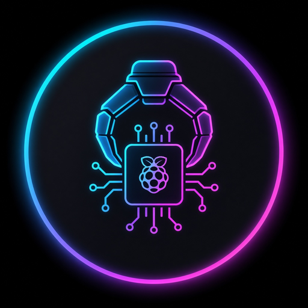
</p>

# Pyra Claw

Raspberry Pi 5 + ESP32 command hub bridging the phone controller to physical devices.

**Package id:** `com.victorious.pyraclaw`

> **Package note:** Android companion applicationId from `android/app/build.gradle.kts`. Hub/hardware itself is not an Android package; ROADMAP lists hardware n/a.

**Status:** planning / scaffold *(from [fleet-manifest ROADMAP](https://github.com/Victorious93/fleet-manifest/blob/main/ROADMAP.md))*

## Install / build

Hub: Python/FastAPI under `hub/`. Android companion: `cd android && ./gradlew assembleDebug` (per existing README). Verify hub install steps in `hub/pyproject.toml`.

_Steps above are taken from this repo’s build files / existing docs; anything not exercised in this refresh is unlabeled as verified on a device._

## Victorious fleet

- Monorepo: [https://github.com/Victorious93/victorious-fleet](https://github.com/Victorious93/victorious-fleet)
- Fleet site: [https://victorious-framework.pages.dev](https://victorious-framework.pages.dev)

<!-- victorious-fleet-readme-refresh:end -->

**Raspberry Pi 5 + ESP32 command hub for the Victorious fleet.** You control it from an Android phone over USB-C tethering or Wi-Fi. The hub relays commands over MQTT to ESP32 nodes. The first node wakes Don's PC with **Wake-on-LAN** and an approval-gated, opto-isolated **PWR_SW pulse** (≤ 300 ms). The Android app works on its own and also registers as a droidcommand-AI `EXTERNAL_NODE`.

> ⚠️ v0.1 scaffold: **CONCEPT / UNTESTED** on real hardware.

## Quick links
- 📘 [Manual](docs/MANUAL.md) · 📡 [Protocol](docs/PROTOCOL.md) · 🖨️ [Case print specs](docs/CASES.md)
- 🐍 [hub/](hub/): FastAPI daemon (Pi OS Bookworm)
- 🔌 [firmware/esp32-wake/](firmware/esp32-wake/): PlatformIO ESP32 node
- 📱 [android/](android/): Kotlin + Compose app

## Visuals
<p>
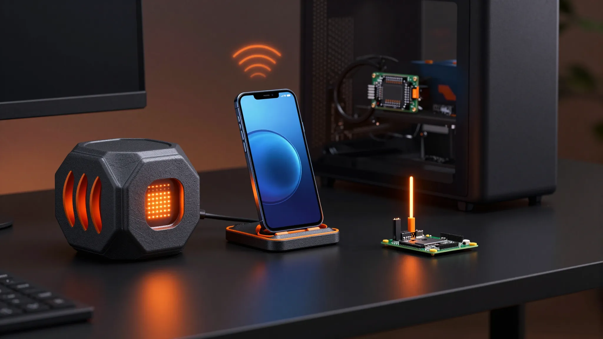
</p>
App v0.4 (real renders of the Compose screens with sample data, via Robolectric; not yet run against real hardware):
<p>
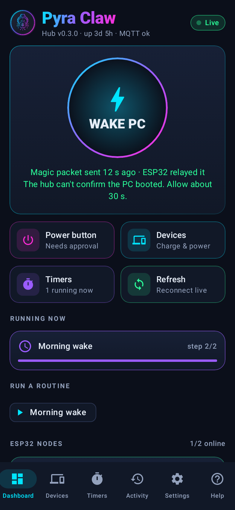
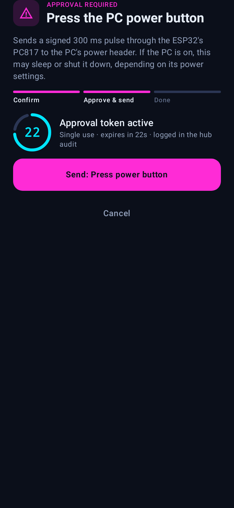
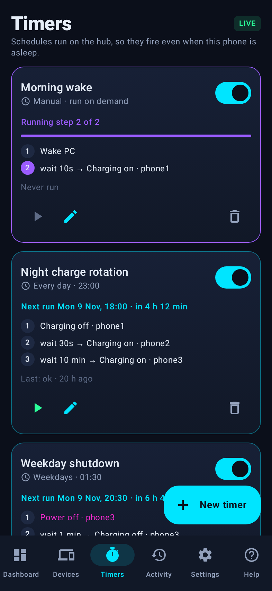
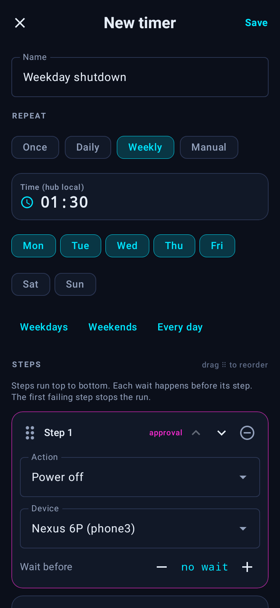
</p>
<p>
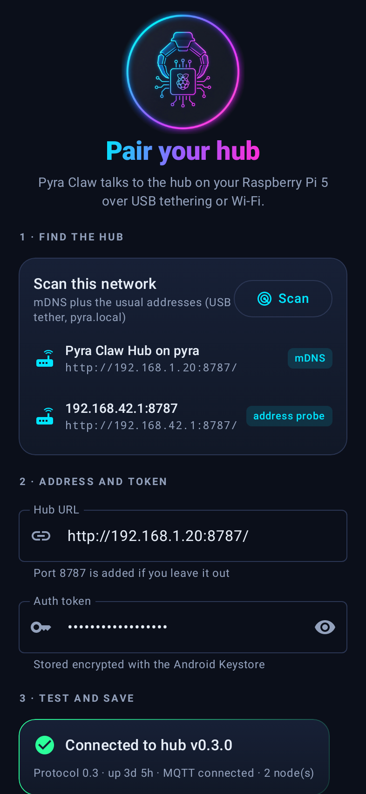
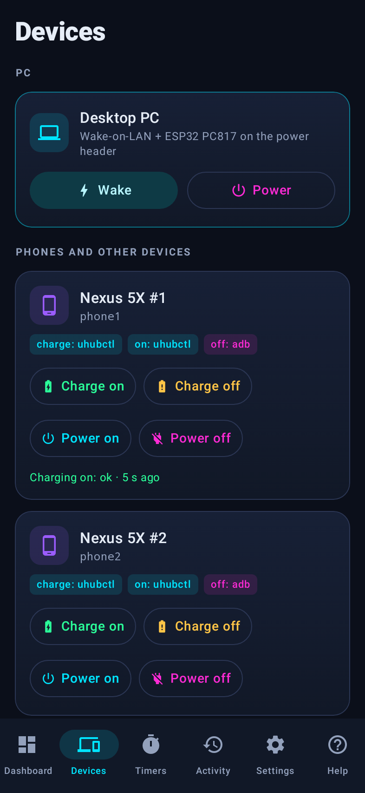
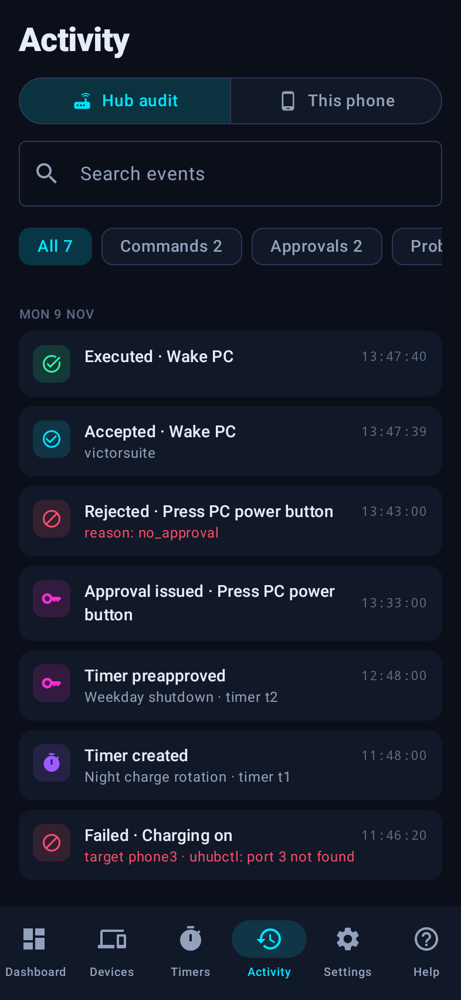
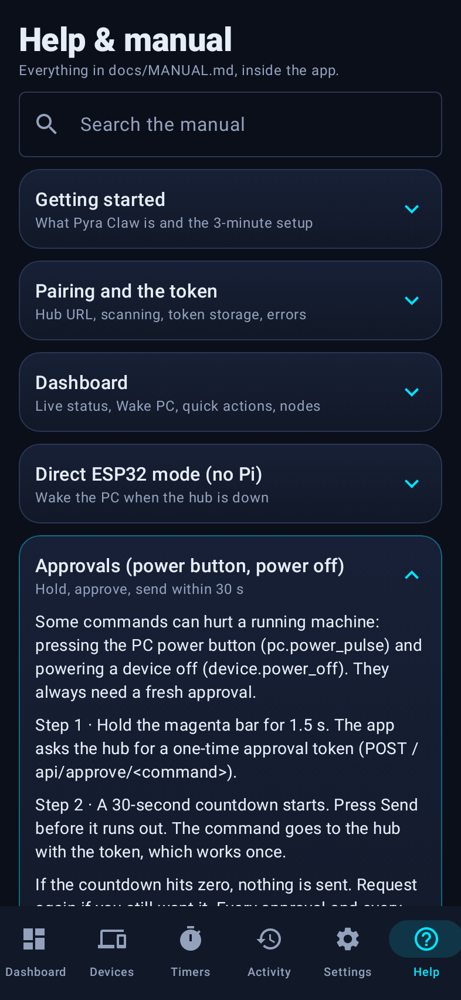
</p>
<p>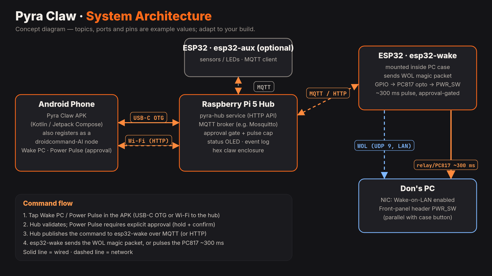</p>

## Quick start
```bash
sudo ./hub/install.sh                       # on the Pi
cd firmware/esp32-wake && pio run -t upload # ESP32 (after creating include/config.h)
cd android && ./gradlew assembleDebug       # APK
```

## License
MIT
