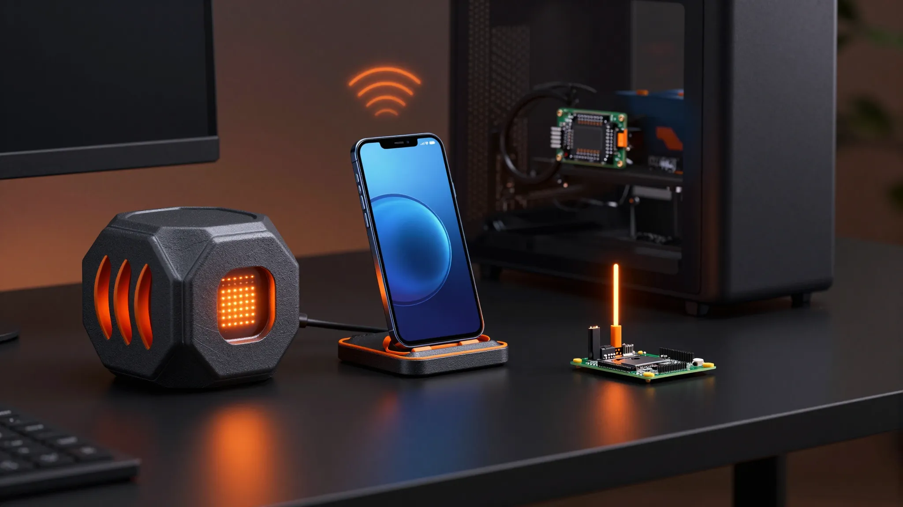
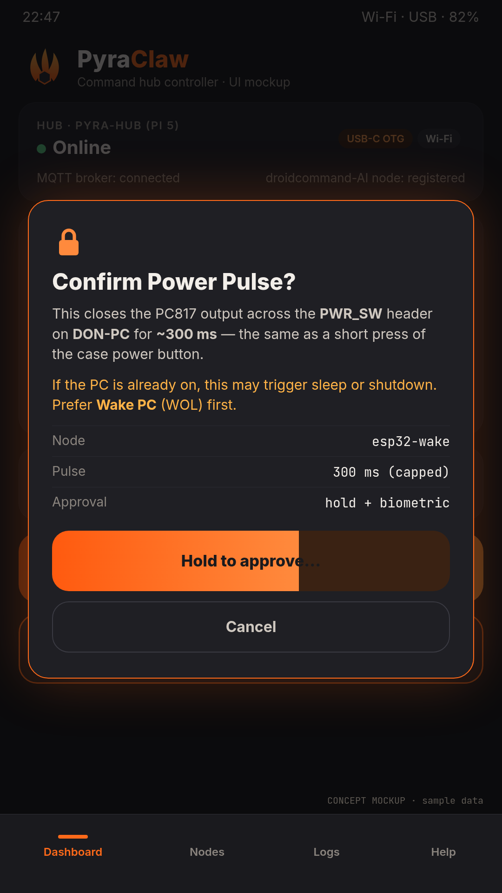
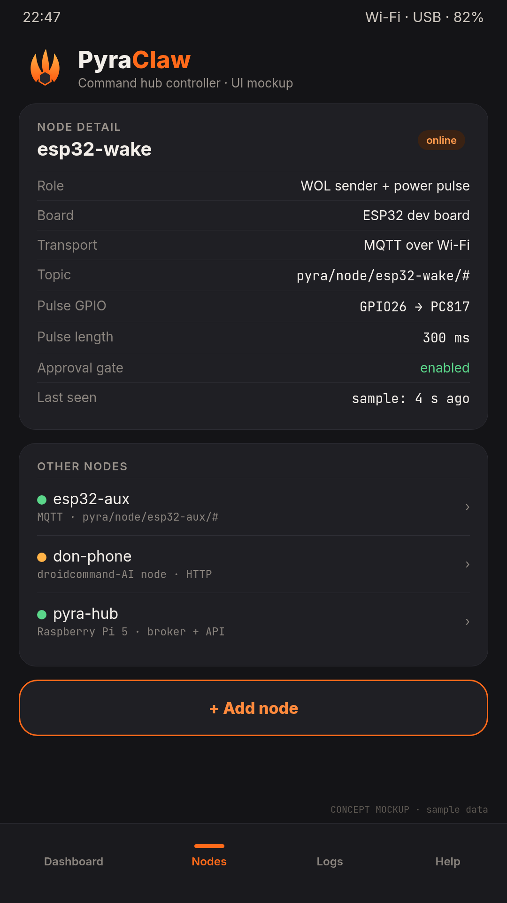

<p align="center"></p>

# Pyra Claw

**Raspberry Pi 5 + ESP32 command hub for the Victorious fleet.** You control it from an Android phone over USB-C tethering or Wi-Fi. The hub relays commands over MQTT to ESP32 nodes. The first node wakes Don's PC with **Wake-on-LAN** and an approval-gated, opto-isolated **PWR_SW pulse** (≤ 300 ms). The Android app works on its own and also registers as a droidcommand-AI `EXTERNAL_NODE`.

> ⚠️ v0.1 scaffold: **CONCEPT / UNTESTED** on real hardware.

## Quick links
- 📘 [Manual](docs/MANUAL.md) · 📡 [Protocol](docs/PROTOCOL.md) · 🖨️ [Case print specs](docs/CASES.md)
- 🐍 [hub/](hub/): FastAPI daemon (Pi OS Bookworm)
- 🔌 [firmware/esp32-wake/](firmware/esp32-wake/): PlatformIO ESP32 node
- 📱 [android/](android/): Kotlin + Compose app

## Visuals
<p>

</p>
<p>



</p>
<p></p>

## Quick start
```bash
sudo ./hub/install.sh                       # on the Pi
cd firmware/esp32-wake && pio run -t upload # ESP32 (after creating include/config.h)
cd android && ./gradlew assembleDebug       # APK
```

## License
MIT
