<div align="center">

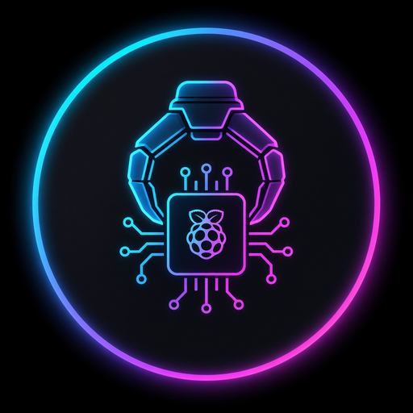

# Pyra Claw

**Raspberry Pi 5 + ESP32 command hub for the Victorious fleet.**

<p>
  <a href="https://github.com/Victorious93/pyra-claw/actions/workflows/ci.yml"></a>
  <a href="https://github.com/Victorious93/pyra-claw/releases"></a>
  
  
  <a href="https://victorious-framework.pages.dev"></a>
</p>

<p><a href="https://github.com/Victorious93/pyra-claw/releases">Releases</a> · <a href="https://victorious-framework.pages.dev">Victorious Framework</a></p>

</div>

---

A Raspberry Pi 5 + ESP32 command hub for the Victorious fleet. You control it from an Android phone over USB-C tethering or Wi-Fi. The hub relays signed commands over MQTT to ESP32 nodes. The first node wakes the owner's PC with **Wake-on-LAN** and an approval-gated, opto-isolated **PWR_SW pulse** (300 ms or less). The Android app works on its own and also registers as a droidcommand-AI `EXTERNAL_NODE`. Package id: `com.victorious.pyraclaw` (the Android companion; the hub and hardware are not Android packages).

> ⚠️ **Concept / untested on real hardware.** Hub, firmware and app features are written and tested in software only (unit tests, mock servers, Robolectric renders). Nothing here has been run against a real Pi, ESP32 or phone yet.

## Features

| Part | What is in the code |
|---|---|
| **Hub** (`hub/`, Python / FastAPI, Pi OS Bookworm) | HTTP API with auth, command queue, device registry, signed messages, MQTT bridge, Wake-on-LAN, power control, and a timer scheduler (device charge/power backends) |
| **Firmware** (`firmware/esp32-wake/`, PlatformIO) | Wake node with an HMAC-gated PWR_SW pulse, NTP (hub chrony first, then `pool.ntp.org`), and `usb_power` channels (protocol v0.4, safe-pin allowlist) |
| **Android app** (`android/`, Kotlin + Compose, v0.5.0) | Pairing, live dashboard, approval countdown, devices, timers editor and tab, activity log, help, and **Direct ESP32 mode** (Wake PC falls back to the node's `POST /wake` when the hub is unreachable) |
| **Hardware** (`hardware/case/`) | Parametric OpenSCAD enclosure for the Pi 5, ESP32, PC817 opto-isolator and Coral, plus a Nexus phone rack variant |
| **Installer** | `hub/install.sh` (including a chrony NTP server for LAN/USB subnets; skip with `--no-ntp`) and `tools/provision.py` |

Direct mode never holds the hub token: the Power button stays hub-only, and hub refusals never fall back to the node.

## Visuals

<p align="center">
  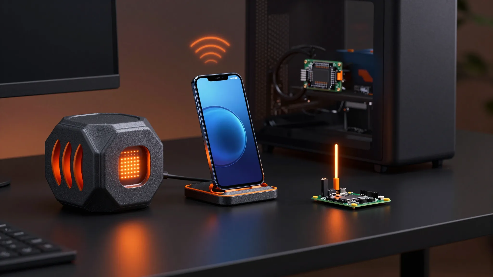
</p>

Renders of the Compose screens with sample data (via Robolectric, not run against real hardware):

<p align="center">
  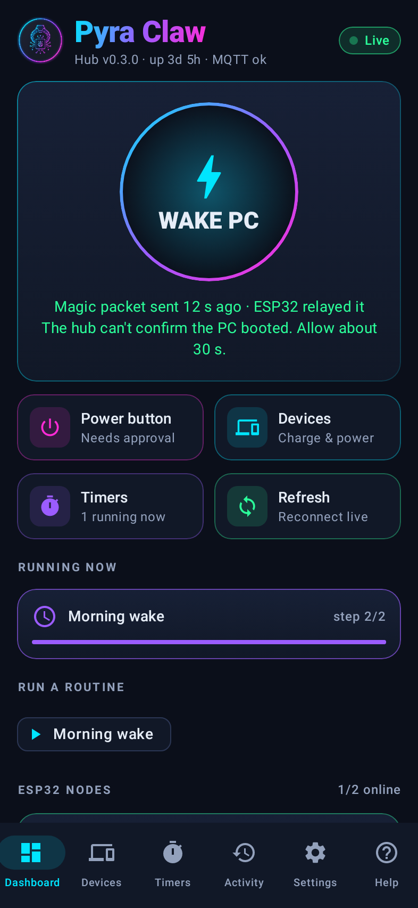
  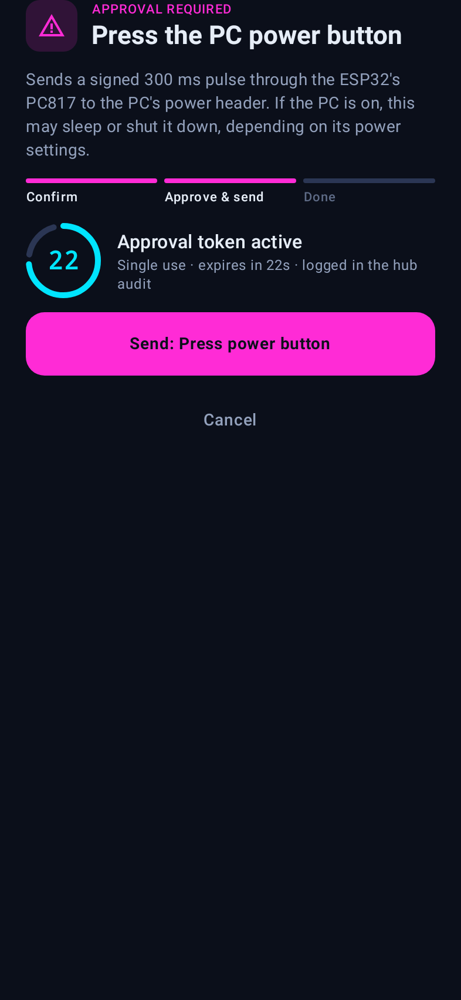
  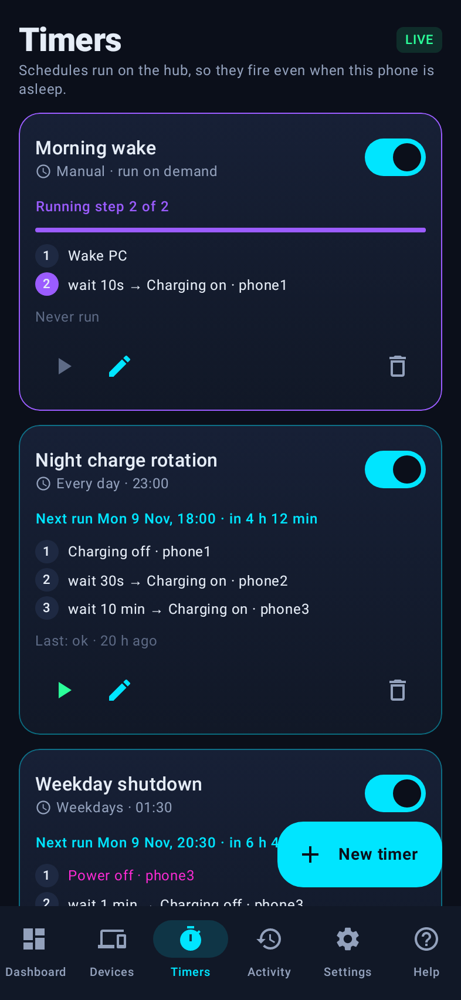
  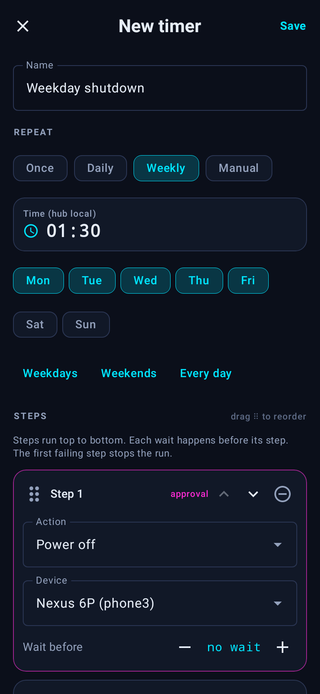
</p>
<p align="center">
  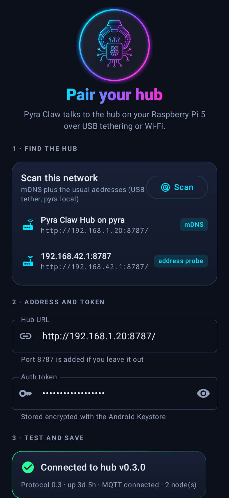
  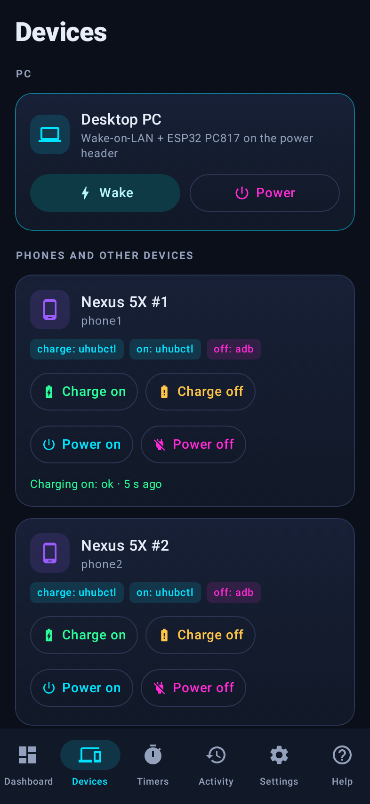
  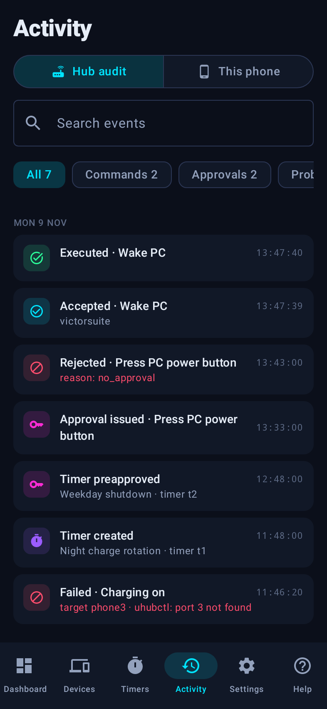
  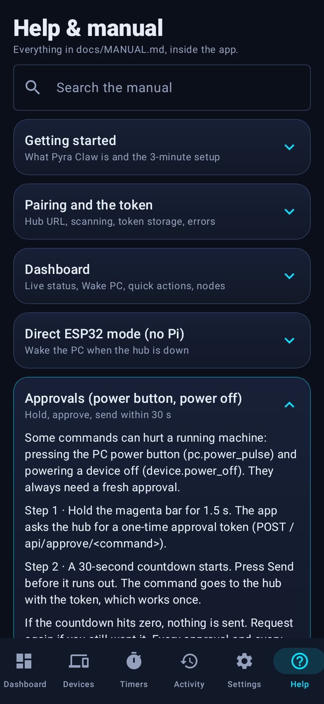
</p>
<p align="center">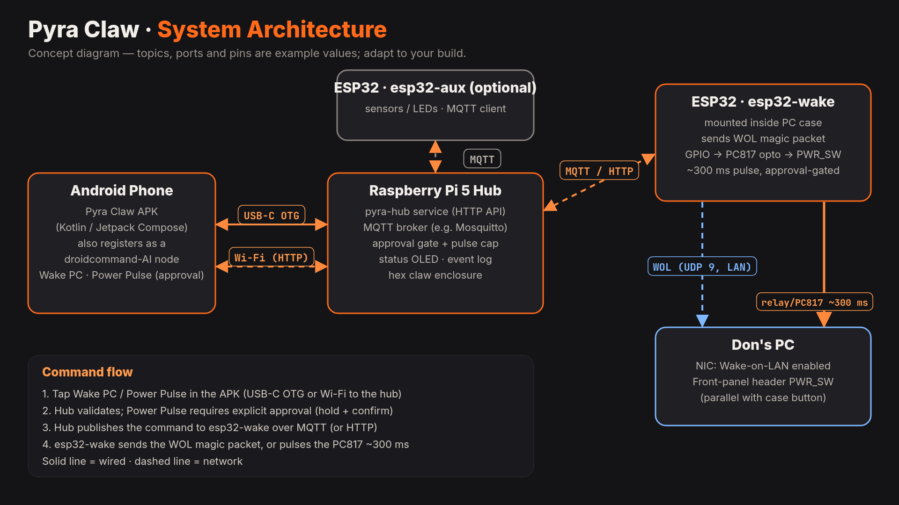</p>

## Install

A debug APK for the Android app is on the [Releases page](https://github.com/Victorious93/pyra-claw/releases) (latest: `v0.1.0-debug`, older than the 0.5.0 source). CI also builds debug APKs. The hub and firmware are installed from source (below). minSdk 26.

## Quick start

```bash
sudo ./hub/install.sh                       # on the Pi
cd firmware/esp32-wake && pio run -t upload # ESP32 (after creating include/config.h)
cd android && ./gradlew assembleDebug       # APK
```

Details: [Manual](docs/MANUAL.md) · [Build guide](docs/BUILD_GUIDE.md) · [Provisioning](docs/PROVISIONING.md) · [Scenarios](docs/SCENARIOS.md) · [Protocol](docs/PROTOCOL.md) · [Case print specs](docs/CASES.md).

## Permissions (Android)

`INTERNET`, `ACCESS_NETWORK_STATE`, `CHANGE_NETWORK_STATE`, `CHANGE_WIFI_MULTICAST_STATE`, `FOREGROUND_SERVICE` (connected device and data sync), `POST_NOTIFICATIONS`, `WAKE_LOCK` and `REQUEST_IGNORE_BATTERY_OPTIMIZATIONS`. No root.

## Safety

The PWR_SW pulse goes through an opto-isolator, is limited to 300 ms and needs approval. Mains and PC wiring are your responsibility: read the wiring section of the [manual](docs/MANUAL.md) first, which is marked concept/untested.

---

## Victorious fleet

Pyra Claw is part of the [Victorious Framework](https://victorious-framework.pages.dev), a family of Android and PC tools by Don Victor. **Every app works standalone; fleet integrations are optional** and never required.

Related: [droidcommand-AI](https://github.com/Victorious93/droidcommand-AI) (fleet controller), [victorious-fleet](https://github.com/Victorious93/victorious-fleet) (index of all fleet apps), [fleet-manifest](https://github.com/Victorious93/fleet-manifest) (fleet status feed). The full roster lives in [victorious-fleet](https://github.com/Victorious93/victorious-fleet), and live status is in [fleet-manifest](https://github.com/Victorious93/fleet-manifest).

## Contributing

Issues and pull requests are welcome. Keep changes focused, match the existing code style, never commit secrets or release keys, and keep any fleet integration optional so the app still works on its own. Open a PR against the default branch and wait for CI to pass.

## License

MIT License, Copyright (c) 2026 Don Victor. See [LICENSE](LICENSE).
