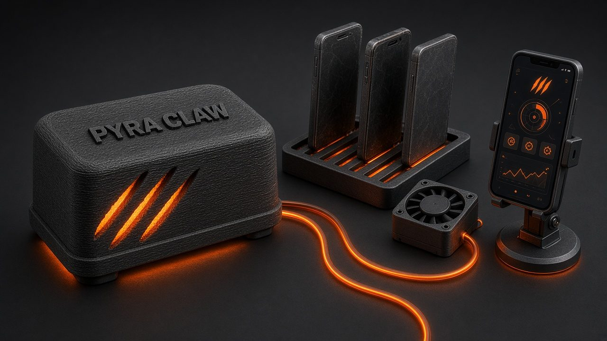
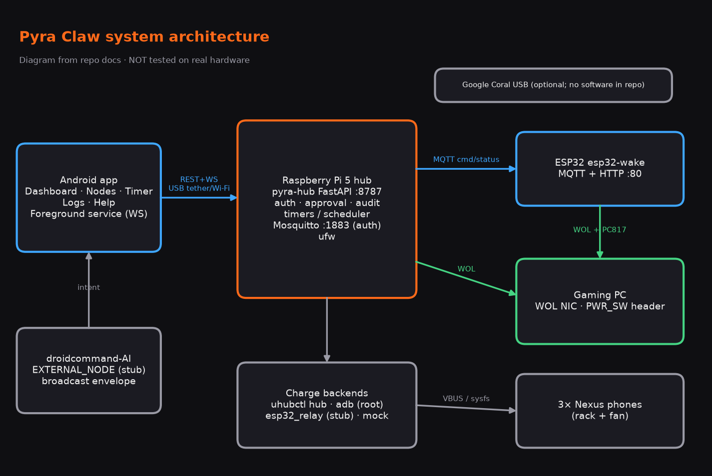
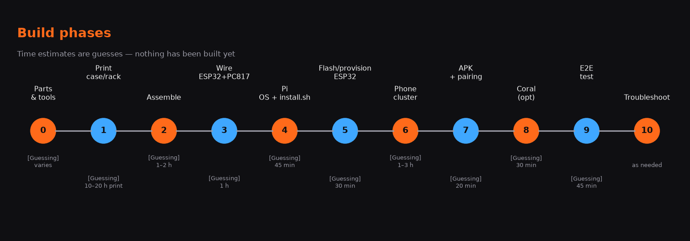
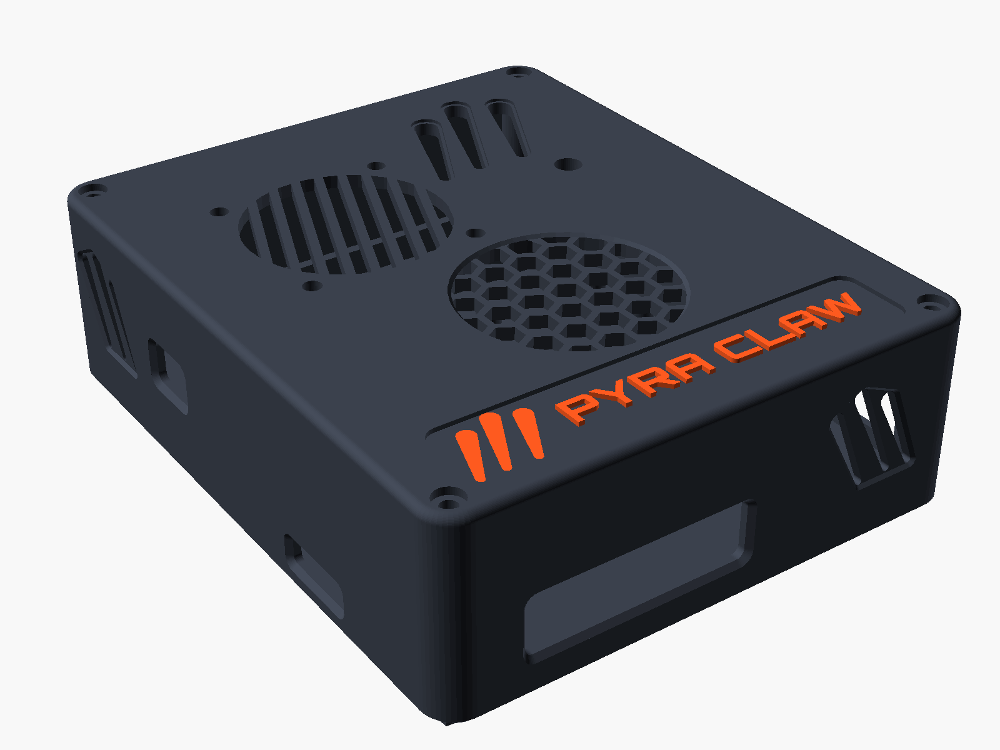
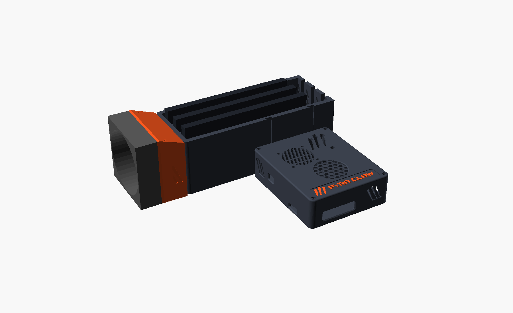
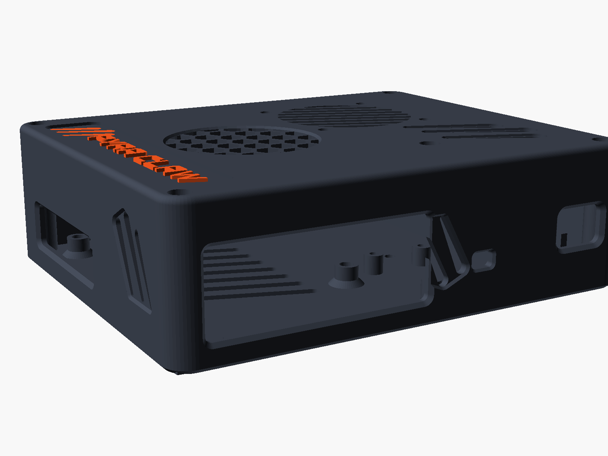
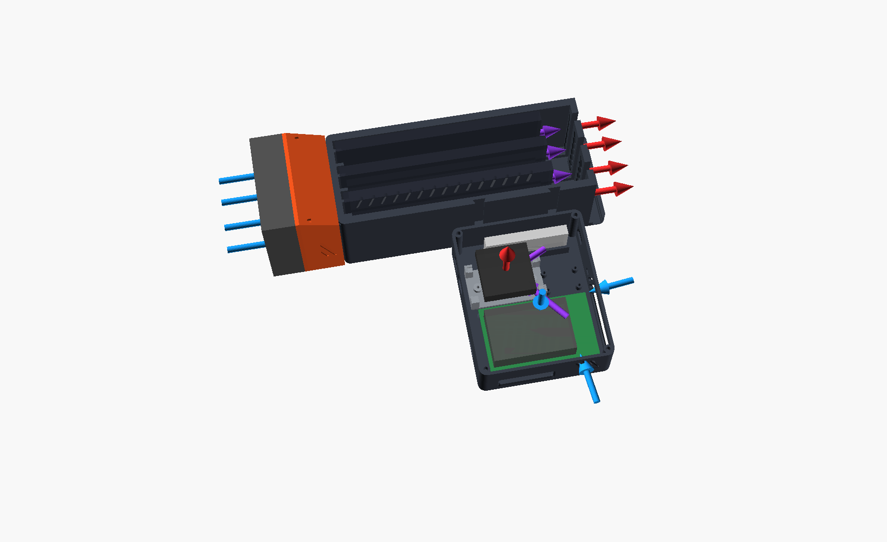
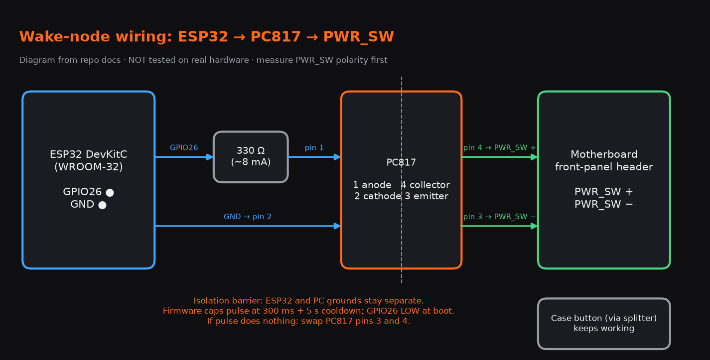
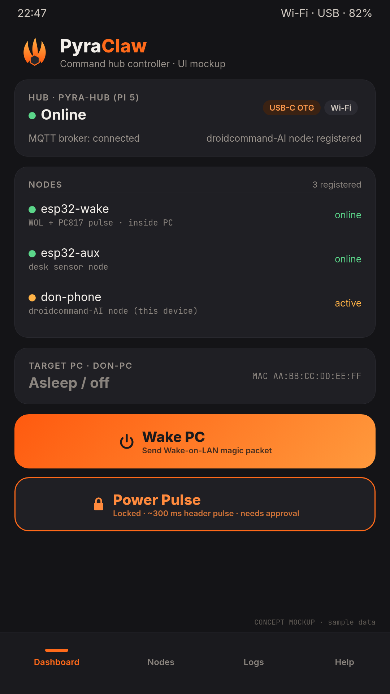

# Pyra Claw: Build Guide


*Illustration generated for this guide. It is not a photo of real hardware.*

> ⚠️ **Nothing in Pyra Claw has been tested on real hardware.** That covers the case, the wiring, the firmware, the hub on a Pi, the phones and the APK on a device. CI only compiles and unit-tests the code (hub `pytest` with mock backends, `pio run`, `./gradlew assembleDebug`). [Certain]
>
> Tags: **[Certain]** = read from the code/docs on `main`. **[Likely]** = well supported, not verified on our hardware. **[Guessing]** = estimate. No prices are given anywhere.

Sources: `main` @ `d178497` (PRs #6–#9), [MANUAL.md](MANUAL.md), [PROTOCOL.md](PROTOCOL.md) v0.3, [PROVISIONING.md](PROVISIONING.md), [CASES.md](CASES.md), [hardware/case/README.md](../hardware/case/README.md), `hub/install.sh`, `tools/provision.py`, `android/`. Use scenarios: [SCENARIOS.md](SCENARIOS.md).






All time estimates are **[Guessing]**; nobody has built one yet.

---

## Phase 0 — Parts and tools · ⏱ varies [Guessing]
- [ ] Raspberry Pi 5 (4 GB+), official 27 W USB-C PSU, Active Cooler, microSD 32 GB+ [Certain, MANUAL BOM]
- [ ] ESP32 DevKitC (WROOM-32), PC817 optocoupler, 330 Ω resistor, Dupont leads, 2-pin header splitter [Certain]
- [ ] Data-capable USB-C cable (phone ↔ Pi tether) [Certain]
- [ ] Case hardware: 8× M2.5×4 heat-set inserts, M2.5 ×6 / ×8 screws, self-taps, 40×40×10 mm **5 V** fan, 80×80×25 mm **5 V** USB fan (or 2×40 mm), 8 rubber bumpers, 3 short right-angle USB cables [Certain, case README BOM]
- [ ] Optional: Google Coral USB Accelerator; a USB hub with **real per-port power switching** (e.g. UUGear MEGA4) for `uhubctl`; up to 3 old Nexus phones (5 / 5X / 6P) [Certain]
- [ ] Tools: FDM printer (220×220 mm bed), PETG, soldering iron for inserts, **multimeter**, a PC to flash the ESP32 (PlatformIO, `pip install pyserial`)

**Verify:** every item on the BOM is on the bench, and the multimeter works in DC-volts mode.

## Phase 1 — Print the case, rack and fans · ⏱ ~10–20 h of printing [Guessing]
| | |
|---|---|
|  |  |
| *OpenSCAD render, v2 assembly* | *OpenSCAD render, rack docked* |

- [ ] Print a tolerance coupon (lid joint + M2.5 boss) first [Likely]
- [ ] **PETG, 0.2 mm layers, 3 perimeters, 20 % gyroid, no supports** [Likely, case README]
- [ ] Parts (`hardware/case/stl/`): `base`, `lid` (or the 3 MMU parts), `esp32-bracket`, `fan-guard`, `phone-rack`, `phone-rack-shroud` (already oriented flange-down) [Certain]
- [ ] Brim 3–5 mm on the rack; slow bridges if port openings (~56 mm) sag [Likely/Guessing]
- [ ] **Two-colour lid, single extruder:** colour change (M600) at **z = 2.2 mm** → wordmark comes out in the 2nd colour [Likely]
- [ ] **Two-colour lid, AMS/MMU:** load `lid-mmu-body.stl` + `lid-inlay-wordmark.stl` + `lid-inlay-claws.stl` **as one object** (shared origin); accent filament on both inlays [Likely]
- [ ] Wordmark font: install *Orbitron ExtraBold* before re-rendering, or OpenSCAD silently substitutes [Certain]


**Verify:** assembled size should be about **102.8 × 123.8 × 37.4 mm**; rack **211.3 × 78.6 × 70 mm** [Certain for the model]. Dry-fit the rack onto the two dovetail rails.

## Phase 2 — Assemble: inserts, Pi, cooler, fans · ⏱ 1–2 h [Guessing]

- [ ] Heat-set 8 M2.5 inserts: 4 Pi standoffs + 4 lid corner bosses [Certain]
- [ ] Fit the Active Cooler to the Pi 5, then screw the Pi down (M2.5×6) [Certain]
- [ ] 40 mm case fan in the lid seat (self-taps from above), blowing **out** through the lid [Certain]
- [ ] Fan wire along the 1.2 mm lid groove to **GPIO pin 4 (5 V) + pin 6 (GND)** — the Active Cooler normally occupies the 4-pin fan JST [Likely]
- [ ] Rack: 80 mm 5 V fan on the shroud; shroud to rack with 2× M2.5×12 self-taps + 2 pegs [Certain]
- [ ] **Never put a 5 V fan on 12 V** [Certain, Noctua]



**Verify:** USB-C, micro-HDMI and Ethernet plugs fully seat (ports sit ~3 mm deeper than v1 — [Guessing]). Fans spin on 5 V.

## Phase 3 — Wire ESP32 + PC817 to the PC front-panel header · ⏱ ~1 h [Guessing]


| From | To |
|---|---|
| ESP32 GPIO26 | 330 Ω → PC817 pin 1 (anode) |
| ESP32 GND | PC817 pin 2 (cathode) |
| PC817 pin 4 (collector) | PWR_SW **+** (measure: the ~3.3–5 V side) |
| PC817 pin 3 (emitter) | PWR_SW **−** |
| Case button | same PWR_SW pins via the splitter |

> ⚠️ **Safety [Certain from MANUAL; untested]:** PC unplugged from mains while wiring. **Measure** PWR_SW polarity with the multimeter first. Never connect the ESP32 directly to the motherboard header; the PC817 is the isolation, keep grounds separate. Firmware caps a pulse at **300 ms** with a **5 s cooldown**; >4 s would force-off most PCs. GPIO26 is held LOW at boot. Strain-relieve the lead; the pod must not short against the board.

**Verify:** with the ESP32 unpowered, the case button still powers the PC on. Continuity from PC817 pins 3/4 to the header pins.

## Phase 4 — Flash Pi OS and run `install.sh` · ⏱ ~45 min [Guessing]
- [ ] Flash **Raspberry Pi OS Bookworm 64-bit**, enable SSH, boot
- [ ] Install:
```sh
git clone https://github.com/Victorious93/pyra-claw.git && cd pyra-claw
sudo ./hub/install.sh                         # default: ufw on, LAN + tether subnets allowed
sudo ./hub/install.sh --allow-from "192.168.1.0/24 192.168.42.0/24"   # explicit subnets
sudo ./hub/install.sh --no-ufw                # skip firewall (or PYRA_NO_UFW=1)
sudo ./hub/install.sh --help
```
Env vars: `PYRA_NO_UFW`, `PYRA_ALLOW_FROM`, `PYRA_SSH_PORT` (default 22), `PYRA_NODE_MQTT_USER` (default `pyra-node`). Safe to re-run; never overwrites secrets [Certain].

What it does [Certain]: installs `python3 python3-venv mosquitto mosquitto-clients` (+`ufw`), creates user `pyra`, venv in `/opt/pyra-claw`, writes `/etc/pyra-claw/config.toml` and root-only `/etc/pyra-claw/node-credentials`, Mosquitto `listener 1883` with `allow_anonymous false`, ufw allowing SSH then 8787/1883 only from connected subnets, and starts `pyra-hub.service`.

- [ ] **Save the printed API token.**
- [ ] Edit `/etc/pyra-claw/config.toml`: set `[pc] mac` (and `broadcast`), then `sudo systemctl restart pyra-hub`
- [ ] PC side: enable Wake-on-LAN in BIOS/UEFI and the NIC driver; disable Windows Fast Startup if WOL from S5 fails

**Verify:**
```sh
systemctl status pyra-hub
curl http://localhost:8787/health
curl -H "Authorization: Bearer <token>" http://localhost:8787/api/status
sudo ufw status
```

## Phase 5 — Flash and provision the ESP32 · ⏱ ~30 min [Guessing]
```sh
cd firmware/esp32-wake && pio run -t upload        # once
pip install pyserial
python tools/provision.py /dev/ttyUSB0 hello --wait-boot
python tools/provision.py /dev/ttyUSB0 provision ssid=home pass=... broker=192.168.4.1 pc_mac=AA:BB:CC:DD:EE:FF
sudo bash -c 'source /etc/pyra-claw/node-credentials; python3 tools/provision.py /dev/ttyUSB0 provision \
  mqtt_user="$NODE_MQTT_USER" mqtt_pass="$NODE_MQTT_PASS" hub_token="$NODE_HUB_TOKEN"'
python tools/provision.py /dev/ttyUSB0 reboot
```
- Serial 115200 8N1, JSON lines; commands accepted for **10 s after boot** or while no SSID is set [Certain]
- `hub_token` must equal hub `[node] hub_token`; the node needs **internet NTP** or it refuses pulses (fail closed) [Certain]
- Keys: `ssid pass broker broker_port node_id mqtt_user mqtt_pass pc_mac pc_broadcast hub_token`

**Verify:** `python tools/provision.py /dev/ttyUSB0 get` (secrets show `***`); `curl http://pyra-esp32-wake-01.local/health` shows `time_synced: true`; on the Pi:
```sh
sudo bash -c 'source /etc/pyra-claw/node-credentials; mosquitto_sub -u "$HUB_MQTT_USER" -P "$HUB_MQTT_PASS" -t "pyra/#" -v'
```
heartbeats every 10 s.

## Phase 6 — Phone cluster: root/adb and the uhubctl hub · ⏱ 1–3 h [Guessing]
- [ ] Phones in the rack **without cases**; rack fan running [Likely]
- [ ] Pi 5 onboard USB ports are **ganged** — use an external **PPPS** hub for per-phone control [Certain, uhubctl README]
- [ ] `install.sh` does **not** install `uhubctl` or `adb`; install them yourself (e.g. `sudo apt install uhubctl adb` — uhubctl ≥ 2.6.0 needed for Pi 5) [Likely]
- [ ] uhubctl: find location/port with `sudo uhubctl`; the hub service needs root or a udev rule [Certain per MANUAL]
- [ ] adb backend: **rooted** phone, USB debugging authorised; profiles `nexus5`, `nexus6`, `generic` [Certain]
- [ ] Add devices to `/etc/pyra-claw/config.toml`, restart `pyra-hub`:
```toml
[devices.phone1]
label = "Nexus 5X on hub port 2"
charge = { backend = "uhubctl", location = "1-1", port = 2 }
[devices.phone2]
charge = { backend = "adb", serial = "ZX1G22ABCD", profile = "nexus6" }
power_off = { backend = "adb", serial = "ZX1G22ABCD" }
[devices.phone3]
charge = { backend = "mock" }
```
- `esp32_relay` is a **stub** (firmware does not implement `usb_power`) [Certain]

> ⚠️ Keep old Li-ion phones at ~40–60 % charge, never block the fan, retire any phone whose back or screen lifts. PETG is not a fire barrier. [Likely]

**Verify:** `GET /api/devices` lists your devices; `charge.off` on phone1 stops charging (check the phone's battery icon).

## Phase 7 — Install the APK, pair, background service · ⏱ ~20 min [Guessing]

*UI mockup from `assets/visuals/`, not a screenshot of the built APK.*
- [ ] Download the `pyra-claw-debug-apk` artifact from the latest green CI run; sideload it
- [ ] USB tethering on (Pi reaches the phone via `usb0`) **or** same Wi-Fi; if the tether subnet appeared after install, re-run `install.sh --allow-from ...`
- [ ] Enter hub URL (`http://<pi-ip>:8787`) and the token
- [ ] Timer tab → **Start service** (foreground "Hub link" notification, WebSocket to hub); grant notification permission (Android 13+)
- [ ] Tap **Battery settings** and exempt the app from battery optimisation [Likely needed for screen-off]

**Verify:** Dashboard shows hub status; Nodes shows `esp32-wake` online; Logs shows audit entries.

## Phase 8 — Optional Google Coral · ⏱ ~30 min [Guessing]
- [ ] The case has a Coral bay on edge along the back wall with a cable pass-through and slash exhaust [Certain]
- [ ] **There is no Coral software in the repo** — no runtime install in `install.sh`, no detection code [Certain]
**Verify:** physical fit only; the device enumerates under `lsusb` [Likely].

## Phase 9 — First end-to-end test · ⏱ ~45 min [Guessing]
- [ ] `/health` 200; `/api/status` 200 with token; 401 without
- [ ] Node online (heartbeat), `time_synced: true`
- [ ] PC **off** → app **Wake PC** → PC boots (WOL)
- [ ] PC off, WOL disabled → **Power Pulse** hold 2 s → PC boots (PC817)
- [ ] Try two pulses within 5 s → second is `rejected_cooldown`
- [ ] Create a `manual` timer with `charge.off`/`charge.on` → **Run** → events stream to Timer tab
- [ ] `/api/audit` shows every action
- [ ] Record what actually happened — these would be the **first real hardware results**

## Phase 10 — Troubleshooting
| Symptom | Check |
|---|---|
| App 401 | Token mismatch vs `/etc/pyra-claw/config.toml` |
| Node offline | `mqtt_user`/`mqtt_pass` vs `node-credentials`; `mosquitto_sub` command above; `sudo ufw status` |
| `rejected_no_time_sync` | node has no internet NTP |
| `rejected_bad_sig` | `hub_token` differs hub ↔ node |
| `rejected_stale_ts` | Pi clock off by >30 s |
| Pulse 503 from hub | no `[node] hub_token` configured |
| WOL does nothing | BIOS WOL off, Fast Startup on, wrong MAC, different subnet |
| Pulse does nothing | PWR_SW polarity → swap PC817 pins 3 and 4 |
| Hub won't start | `journalctl -u pyra-hub -e`; token must not be `CHANGE_ME` |
| Timer 403 on save | gated step needs `POST /api/approve/timer.arm` token |
| Timer step 502/422 | unknown device or backend not configured |
| Phone keeps charging | hub not PPPS / uhubctl wrong port; adb profile path differs per kernel |
| App drops when screen off | service not started, or battery optimisation still on |

Older install blueprint Page: <https://cursor.com/canvas/store-c8579caf-2138-40fa-9f91-70760b1db27a/5f48dcc7-dc49-435b-b176-eae46b422d67>
