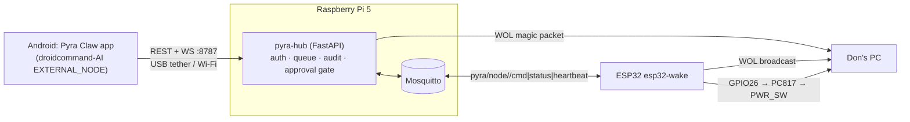
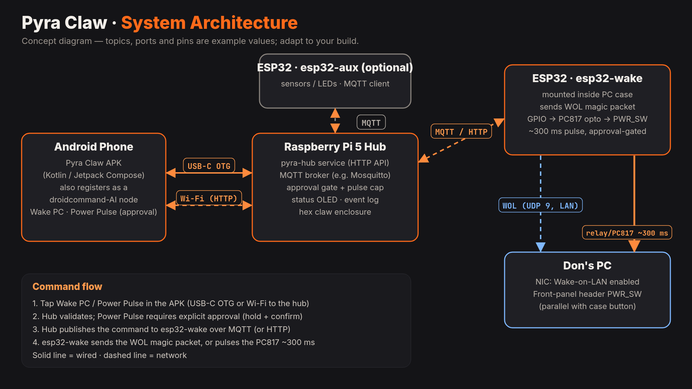
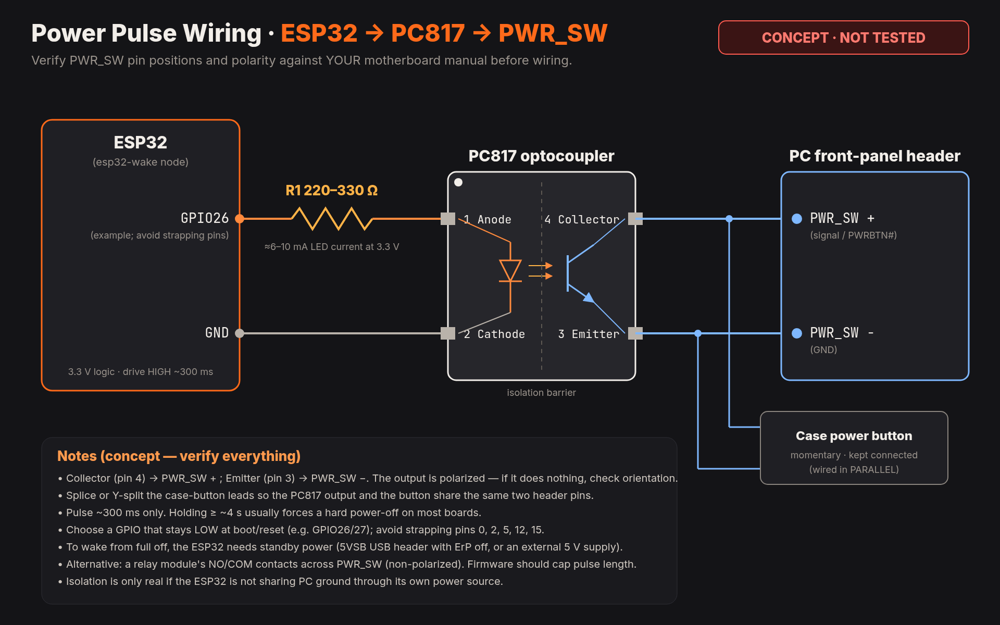
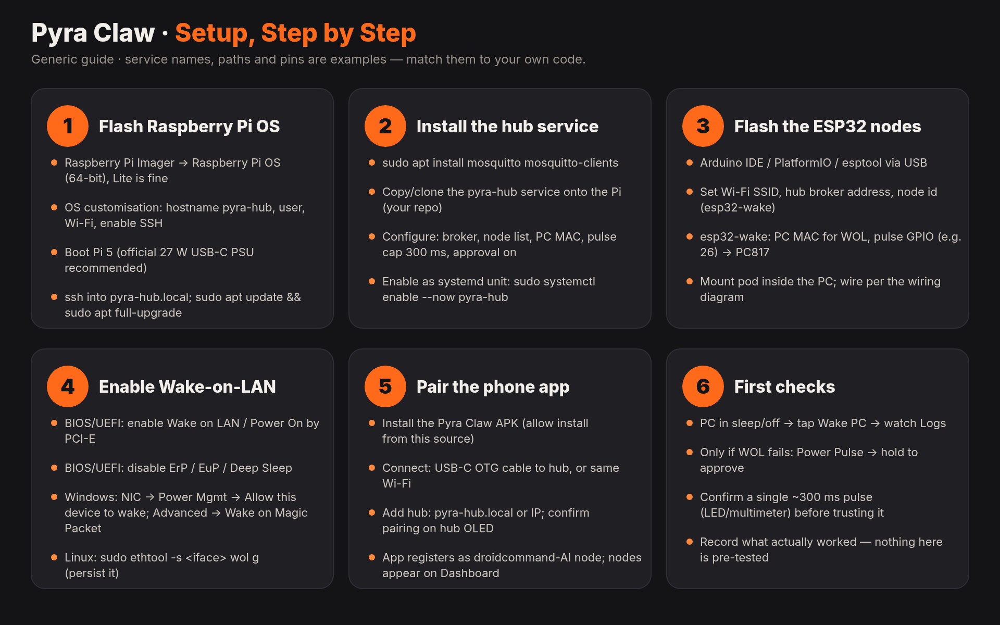

# Pyra Claw: Manual

> ⚠️ **CONCEPT / UNTESTED.** v0.1 is a scaffold. Nothing in it has been tested on real hardware yet. Check every wiring step with a multimeter before you connect it to a PC.

## 1. Overview
Pyra Claw is a command hub built on a Raspberry Pi 5. You control it from an Android phone over USB-C OTG tethering or Wi-Fi. The hub relays commands over MQTT to ESP32 nodes. The first node, **esp32-wake**, can turn on Don's PC in two ways:
- **Wake-on-LAN** (sent by both the hub and the node), and
- an opto-isolated **PC817** pulse across the motherboard **PWR_SW** header (~300 ms, hard-capped in firmware, approval-gated).

The Android app (**Pyra Claw**) works on its own. It also registers as a droidcommand-AI `EXTERNAL_NODE` and accepts `remote.command` / `macro.step` envelopes.

## 2. Architecture

## 3. Hardware BOM
| Qty | Part | Notes |
|---|---|---|
| 1 | Raspberry Pi 5 (4 GB+) | Official 27 W USB-C PSU, Active Cooler |
| 1 | microSD 32 GB+ | Raspberry Pi OS Bookworm 64-bit |
| 1 | ESP32 DevKitC (WROOM-32) | wake node |
| 1 | PC817 optocoupler (DIP or breakout) | isolates ESP32 from motherboard |
| 1 | 330 Ω resistor | ESP32 GPIO26 → PC817 LED current limit (~8 mA) |
| 1 | Dupont leads + 2-pin header splitter | to share PWR_SW with the case button |
| 1 | USB-C cable (data) | phone ↔ Pi tethering |
| opt | 3D-printed cases | see [CASES.md](CASES.md) |

## 4. Wiring ⚠️ CONCEPT / UNTESTED

| From | To | Notes |
|---|---|---|
| ESP32 GPIO26 | 330 Ω → PC817 pin 1 (anode) | |
| ESP32 GND | PC817 pin 2 (cathode) | |
| PC817 pin 4 (collector) | PWR_SW **+** (pin with higher voltage, ~3.3–5 V) | **Measure first** |
| PC817 pin 3 (emitter) | PWR_SW **−** (ground side) | |
| Case power button | same PWR_SW pins via splitter | button keeps working |

> ⚠️ **UNTESTED:** If the polarity is wrong, the pulse won't trigger. It won't damage anything because the opto isolates the ESP32, but check it before you rely on it. Never connect the ESP32 directly to the motherboard header. Keep the ESP32 and the PC on separate grounds. The opto is what provides the isolation.

> ⚠️ A press longer than ~4 s force-powers-off most PCs. The firmware caps a pulse at **300 ms** and enforces a **5 s cooldown**.

## 5. Install

1. **Pi:** Flash Bookworm 64-bit, then `git clone` this repo and run `sudo ./hub/install.sh`. Save the printed token. Edit `/etc/pyra-claw/config.toml` and set `pc.mac`, then run `sudo systemctl restart pyra-hub`.
2. **PC:** Enable Wake-on-LAN in BIOS/UEFI and in the NIC driver (Windows: *Wake on Magic Packet*). Turn off Fast Startup if WOL from S5 fails.
3. **ESP32:** Copy `firmware/esp32-wake/include/config.example.h` to `config.h` and fill in Wi-Fi, the hub IP and the PC MAC. Then run `pio run -t upload`.
4. **Phone:** Install the APK from the CI artifact. Turn on USB tethering (Pi usually reaches it via `usb0`; set the hub URL accordingly) or join the same Wi-Fi. Enter the hub URL and token.

## 6. Usage
- **Dashboard:** hub status, **Wake PC**, and **Power Pulse** (opens the hold-to-confirm dialog; hold 2 s).
- **Nodes:** online/offline state from heartbeats and the LWT.
- **Logs:** the hub audit log (accepted, rejected and executed commands).
- **Help:** a short setup guide.

## 7. Commands
| Command | Approval | What it does |
|---|---|---|
| `hub.status` | no | hub info |
| `node.list` | no | list nodes |
| `pc.wake` | no | WOL from the hub, plus `wake_pc` on the node |
| `pc.power_pulse` | **yes** | 300 ms PWR_SW pulse |

Full spec: [PROTOCOL.md](PROTOCOL.md).

## 8. Safety
- `pc.power_pulse` needs a single-use approval token (30 s TTL) from the hub **and** the hold-to-confirm gesture on the phone.
- The firmware hard-caps a pulse at 300 ms, so a larger value from the hub is ignored. It also enforces a cooldown, and GPIO26 stays LOW at boot.
- Every command is written to the audit log at `/var/lib/pyra-claw/audit.jsonl`.
- The auth token gates every API call. Keep the hub on a trusted network or the USB tether, and never expose port 8787 to the internet.

## 9. Troubleshooting
| Symptom | Check |
|---|---|
| App says 401 | Token is wrong. Compare it with `/etc/pyra-claw/config.toml` |
| Node shows offline | ESP32 Wi-Fi/MQTT settings in `config.h`. Run `mosquitto_sub -t 'pyra/#' -v` on the Pi |
| WOL doesn't wake the PC | BIOS WOL is off, Fast Startup is on, MAC is wrong, or the PC is on a different subnet |
| Pulse does nothing | PWR_SW polarity. Swap the PC817 pins 3 and 4 |
| Hub won't start | `journalctl -u pyra-hub -e`. The token must not be `CHANGE_ME` |

## 10. Help
- Open an issue in this repo.
- See `docs/PROTOCOL.md` and `docs/CASES.md`, and the Help tab in the app.
