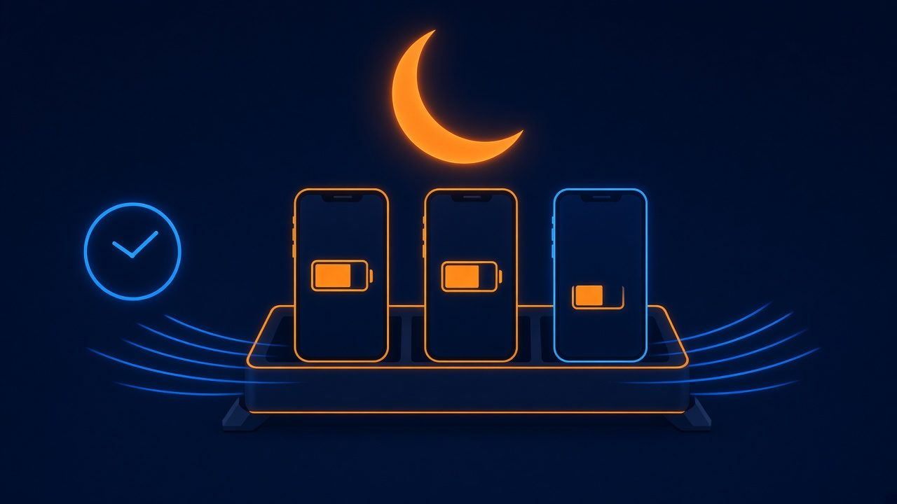
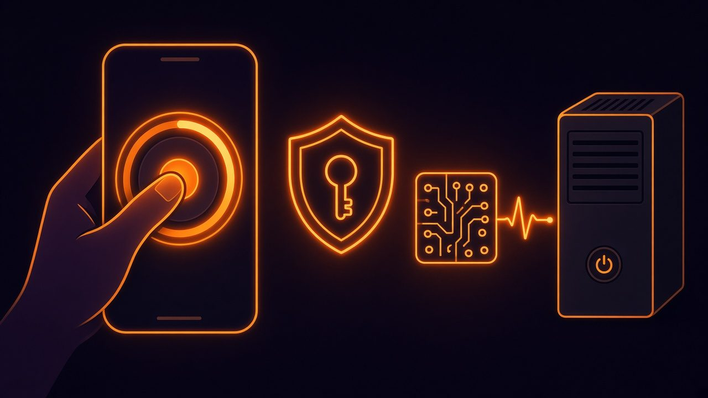
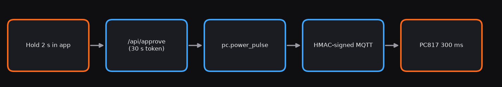
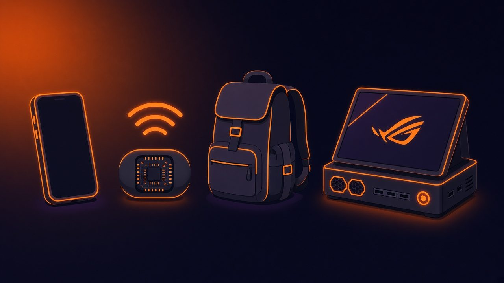
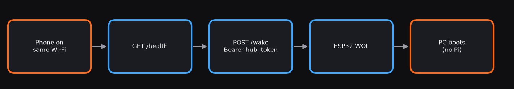
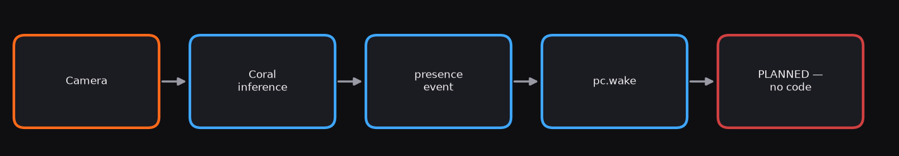
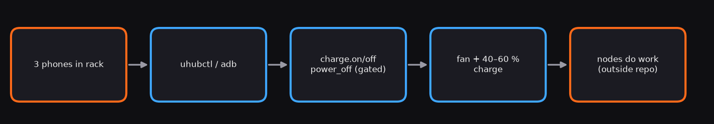
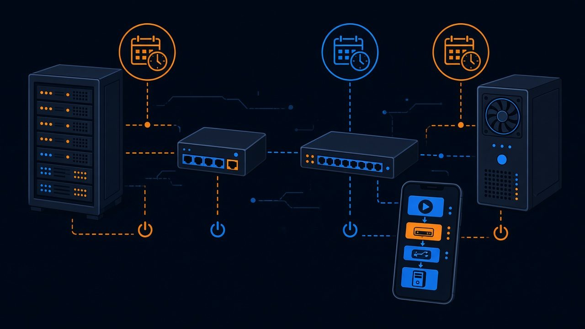
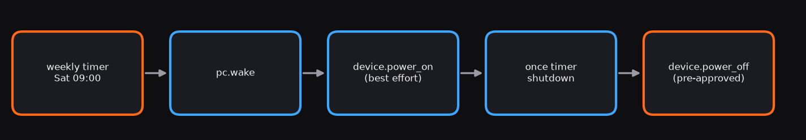
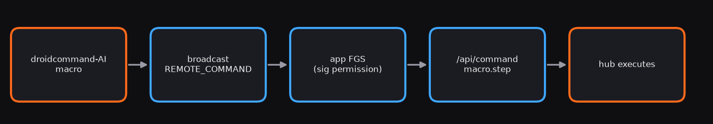

# Pyra Claw: Use Scenarios

> ⚠️ **Nothing here has been tested on real hardware.** "Works in code" means the code path exists on `main` and has unit tests with mock backends, not that it has worked on a real PC, ESP32 or phone. [Certain]
> Illustrations are generated art, **not photos**. Flow diagrams are drawn from the code.

Status key: 🟢 **Works in code** · 🟡 **Needs hardware** (code exists but depends on hardware/setup not yet done, or a backend is hardware-specific) · 🔴 **Planned** (no code)

All API calls: `Authorization: Bearer <token>` against `http://<pi>:8787`. Build steps: [BUILD_GUIDE.md](BUILD_GUIDE.md).

| # | Scenario | Hardware | Status |
|---|---|---|---|
| 1 | Wake the gaming PC from the phone | Pi, ESP32 (optional), phone | 🟢 Works in code |
| 2 | Auto-wake PC for VictorSuite heavy jobs | Pi | 🟢 Works in code |
| 3 | Nightly charge rotation of 3 phones | Pi, PPPS hub or rooted phones | 🟡 Needs hardware |
| 4 | Morning sequence (PC on, phones charge) | Pi, ESP32, hub/phones | 🟡 Needs hardware |
| 5 | Remote hard-reset/power with approval gate | Pi, ESP32 + PC817 | 🟢 Works in code |
| 6 | ESP32-only travel mode | ESP32 only | 🟡 Needs hardware (app doesn't call it yet) |
| 7 | Coral presence detection wakes PC | Pi, Coral, camera | 🔴 Planned |
| 8 | Phone cluster as compute/automation nodes | Pi, rack, 3 phones | 🟡 Needs hardware (power side only) |
| 9 | Homelab power scheduling | Pi, ESP32, devices | 🟡 Needs hardware |
| 10 | droidcommand-AI macros | phone with both apps | 🟡 Stub |

---

## 1. Wake the gaming PC from the phone


- **Goal:** turn the PC on from the couch.
- **Hardware:** Pi hub + phone; ESP32 adds a second WOL sender on the PC's LAN.
- **Setup:** set `[pc] mac` in config → app Dashboard → **Wake PC**.
- **Command:**
```json
{"type":"remote.command","id":"1b9d…","command":"pc.wake","target":null,"args":{},"approval_token":null,"source":"pyra-claw-android","ts":0}
```
Result `{wol_bytes, relayed}`. **Status: 🟢 Works in code** [Certain]; real wake depends on BIOS/NIC WOL [Likely].

## 2. Auto-wake the PC for VictorSuite heavy jobs

- **Goal:** VictorSuite wakes the PC before a heavy job.
- **Hardware:** Pi hub on the same LAN as the PC.
- **Setup:** give VictorSuite the hub URL + token; it POSTs `pc.wake` with `"target": null` (kept backward compatible since v0.1) [Certain, PROTOCOL]. Waiting for the PC to come up is VictorSuite's job [Guessing about its implementation].
```sh
curl -X POST -H "Authorization: Bearer $TOKEN" -H 'Content-Type: application/json' \
  -d '{"type":"remote.command","id":"vs-job-42","command":"pc.wake","target":null,"args":{}}' \
  http://pi:8787/api/command
```
**Status: 🟢 Works in code** (hub side).

## 3. Nightly charge rotation of the 3 phones


- **Goal:** don't keep old batteries at 100 % all night.
- **Hardware:** PPPS USB hub (`uhubctl`) or rooted phones (`adb`); rack + fan.
- **Setup:** `[devices.phoneN]` in config → app **Timer** → New → Daily 23:00 → add steps with delays.
```json
{"name":"Night charge off","enabled":true,"schedule":{"kind":"daily","time":"23:00"},
 "steps":[{"command":"charge.off","target":"phone1","delay_s":0},
          {"command":"charge.off","target":"phone2","delay_s":10},
          {"command":"charge.off","target":"phone3","delay_s":10}]}
```
Pair it with a 05:30 `charge.on` timer. True "rotation" (charging one phone at a time) is just more steps with longer delays. No battery-level reading exists in the hub [Certain], so this is time-based. **Status: 🟡 Needs hardware**; the scheduler is unit-tested with mock [Certain]; `generic` adb profile may only pause at a level [Guessing].

## 4. Morning sequence (PC on, phones charge)


```json
{"name":"Weekday morning","enabled":true,"schedule":{"kind":"weekly","time":"07:00","days":[0,1,2,3,4]},
 "steps":[{"command":"pc.wake","target":null,"delay_s":0},
          {"command":"charge.on","target":"phone1","delay_s":5},
          {"command":"charge.on","target":"phone2","delay_s":5},
          {"command":"charge.on","target":"phone3","delay_s":5}]}
```
No gated steps → no approval needed. If the hub is down at 07:00 the run is **skipped**, not replayed [Certain]. **Status: 🟡 Needs hardware.**

## 5. Remote PC hard-reset / power with an approval gate


- **Goal:** press the real power button remotely when the PC hangs or WOL fails.
- **Hardware:** Pi, ESP32 + PC817 on PWR_SW (Phase 3), node with NTP.
- **Setup:** Dashboard → **Power Pulse** → hold 2 s. Via API:
```sh
curl -X POST -H "Authorization: Bearer $TOKEN" http://pi:8787/api/approve/pc.power_pulse   # {approval_token, ttl_s:30}
curl -X POST -H "Authorization: Bearer $TOKEN" -H 'Content-Type: application/json' \
  -d '{"type":"remote.command","id":"r1","command":"pc.power_pulse","target":null,"args":{"ms":300},"approval_token":"<token>"}' \
  http://pi:8787/api/command
```
Hub → node frame: `{"action":"power_pulse","id":"r1","ms":300,"ts":…,"sig":"<hmac>"}`. Max 300 ms, 5 s cooldown, replay/stale rejection [Certain]. Note: a 300 ms press is a **power toggle**, not a forced hard-reset; a stuck PC that ignores a short press will **not** be forced off (>4 s is blocked by design) [Likely]. **Status: 🟢 Works in code.**

## 6. ESP32-only travel mode (no Pi)


- **Goal:** take just the ESP32 pod; wake the PC from any device on the same LAN.
- **Setup:** provision Wi-Fi, `pc_mac`, `hub_token`.
```sh
curl http://pyra-esp32-wake-01.local/health
curl -X POST -H "Authorization: Bearer $HUB_TOKEN" http://pyra-esp32-wake-01.local/wake
```
`/pulse` needs a signed body (generate with `hub/src/pyra_hub/signing.py`) and NTP. Plain HTTP — trusted LAN only. The **Android app does not call these endpoints yet** [Certain]. **Status: 🟡 Needs hardware.**

## 7. Coral presence detection wakes the PC


- **Idea:** a camera + Coral model on the Pi detects a person and sends `pc.wake`.
- **Reality:** only a case bay exists; no Coral runtime, camera or detection code [Certain]. A detector could later POST the same `pc.wake` JSON as scenario 1 [Guessing].
**Status: 🔴 Planned.**

## 8. Phone cluster as compute / automation nodes

- **Goal:** reuse 3 Nexus phones as always-on workers.
- **What exists:** rack + fan, per-phone `charge.on/off`, `device.power_on` (best-effort, [Guessing]), `device.power_off` (adb `reboot -p`, approval-gated) [Certain].
- **What doesn't:** any job scheduling/compute on the phones — that's outside this repo [Certain].
```json
{"type":"remote.command","id":"c1","command":"device.power_off","target":"phone2","args":{},"approval_token":"<from /api/approve/device.power_off>"}
```
**Status: 🟡 Needs hardware** (power side); compute itself not in scope.

## 9. Homelab power scheduling


```json
{"name":"Weekend lab","enabled":true,"schedule":{"kind":"weekly","time":"09:00","days":[5]},
 "steps":[{"command":"pc.wake","target":null,"delay_s":0},
          {"command":"device.power_on","target":"phone1","delay_s":30}],
 "approval_token":null}
```
For a scheduled shutdown with `device.power_off`, saving needs a `timer.arm` token (`POST /api/approve/timer.arm`); the hub records `timer_preapproved`; editing the steps needs a new token [Certain]. There is no PC shutdown command (only the 300 ms pulse) [Certain]. **Status: 🟡 Needs hardware.**

## 10. Pairing with droidcommand-AI macros

- droidcommand-AI sends broadcast `ai.droidcommand.action.REMOTE_COMMAND` with extra `envelope`; receiver protected by signature permission `com.victorious.pyraclaw.permission.EXTERNAL_NODE` (same signing key) [Certain].
- Only while the Pyra Claw service is running; gated commands still need `approval_token` [Certain].
```json
{"type":"macro.step","macro_id":"morning","step":0,
 "command":{"type":"remote.command","id":"m0","command":"pc.wake","target":null,"args":{},"approval_token":null,"source":"droidcommand-ai","ts":0}}
```
**Status: 🟡 Stub** — the EXTERNAL_NODE contract is not final.
