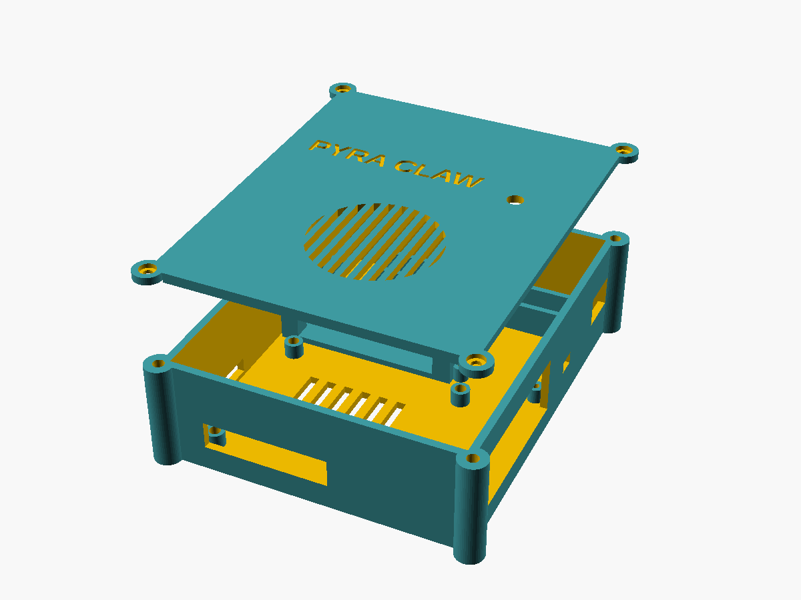

# Pyra Claw case v1 (Pi 5 + ESP32 + PC817 + Coral)

Parametric OpenSCAD enclosure: one base, one screw-on lid and an optional ESP32 bracket.
**It has not been test-printed or fit-checked against real hardware.** Treat every number below as a starting point, and print a tolerance coupon first.

Tags: **[Certain]** = taken from an official drawing or datasheet. **[Likely]** = common practice or a secondary source. **[Guessing]** = design estimate; measure it.



| File | What it is |
|---|---|
| `params.scad` | **All dimensions.** Edit here only. |
| `case.scad` | Geometry modules (`base()`, `lid()`, `esp32_bracket()`) |
| `base.scad`, `lid.scad`, `esp32-bracket.scad` | One part per file, for CLI renders |
| `preview-assembly.scad` | Exploded view with ghost boards |
| `stl/*.stl` | Pre-rendered parts (OpenSCAD 2021.01) |
| `preview/*.png` | Render previews |

Re-render:
```sh
for p in base lid esp32-bracket; do openscad -o stl/$p.stl $p.scad; done
openscad --render --imgsize=1200,900 --camera=0,0,0,55,0,25,0 --viewall --autocenter -o preview/assembly.png preview-assembly.scad
```

## Overall size
- Base: **105.8 × 126.8 × 34.4 mm** (box 96.8 × 117.8 mm plus Ø9 corner screw lugs). Interior 92 × 113 × 32 mm.
- Lid: 105.8 × 126.8 mm, 2.4 mm plate + 3 mm locating lip (5.4 mm total).
- Assembled height: about **36.8 mm**.
- ESP32 bracket: 59.6 × 32.6 × 13.1 mm.

## Layout
- **Pi 5** sits in the front-left on four M2.5 standoffs, 5 mm high. Openings:
  - Front wall: USB-C power and 2× micro-HDMI (one slot).
  - Right wall: Ethernet, 2× USB3 and 2× USB2 (one opening).
  - Left wall: microSD (under the board).
  - Floor: intake slots.
  - Lid: slotted Ø40 grille above the Active Cooler fan.
- **ESP32 DevKit** sits behind the Pi, in a bracket with corner ledges that lift the PCB 10 mm so the header pins clear. The bracket is held by 2 screws from under the base. Its USB opening is in the left wall.
- **Perfboard** (PC817 + resistor, 30 × 20 mm default) sits on 4 self-tap standoffs at the right of the same strip.
  - 6 × 4 mm exit in the right wall for the 2-wire lead to the PC's front-panel PWR_SW header.
  - Optional Ø5.2 status-LED hole in the lid above it.
- **Coral USB Accelerator** stands on its long edge in a rail slot along the back wall. A 14 × 10 mm pass-through in the right wall lets its USB-C cable reach the Pi's USB3 port from outside (the Pi's USB ports face outward).
- **"PYRA CLAW"** is debossed 0.8 mm into the lid's outer face.

## Source dimensions
| Item | Value | Source | Tag |
|---|---|---|---|
| Pi 5 PCB | 85 × 56 mm | [RP-008347-DS Raspberry Pi 5 mechanical drawing](https://pip-assets.raspberrypi.com/categories/892-raspberry-pi-5/documents/RP-008347-DS-1-raspberry-pi-5-mechanical-drawing.pdf) | [Certain] |
| Pi 5 holes | 4 × Ø2.7, 58 × 49 mm pattern, 3.5 mm from the edges | same drawing | [Certain] |
| Pi 5 port centres | USB-C x=11.2; micro-HDMI x=25.8 / 39.2; right edge y=10.2 / 29.1 / 47.0 | same drawing | [Certain] |
| Port housing sizes / overhang | simplified as one opening per wall | estimate | [Guessing] |
| microSD position | left short edge, underside, near mid-width | drawing + board photos | [Likely] |
| Active Cooler envelope | 63.5 × 42.5 × 13.7 mm | Raspberry Pi Active Cooler drawing (quoted in [this enclosure write-up](https://smith.hexdocs.pm/raspberry-pi-enclosure-notebook.html)) | [Likely] |
| Fan centre | ~(42, 34) mm in board coords; the grille is oversized to allow for error | estimate | [Guessing] |
| Coral USB Accelerator | 65 × 30 × 8 mm, USB-C | [Coral datasheet](https://gweb-coral-full.uc.r.appspot.com/docs/accelerator/datasheet/), [product page](https://gweb-coral-full.uc.r.appspot.com/products/accelerator/) | [Certain] |
| ESP32 DevKit 38-pin | ~55 × 28 mm, varies by vendor | [Espressif ESP32-DevKitC docs](https://docs.espressif.com/projects/esp-dev-kits/en/latest/esp32/esp32-devkitc/user_guide.html), vendor listings | [Likely] — measure yours |
| Perfboard | 30 × 20 mm default | your board | [Guessing] |
| M2.5 heat-set insert hole | Ø3.6 × 5 mm | typical for M2.5 × 4 inserts; check your insert's datasheet | [Guessing] |

## Print settings
| Setting | Value | Tag |
|---|---|---|
| Material | **PETG** (the Pi 5 runs warm; PLA softens around 55–60 °C) | [Likely] |
| Layer height | 0.20 mm | [Likely] |
| Perimeters | 3 (walls are 2.4 mm) | [Likely] |
| Infill | 20 % gyroid (bracket 30 %) | [Likely] |
| Supports | **None.** The base prints floor-down. The lid prints **outer face down** (the STL is already oriented that way; the lettering faces the bed). The bracket prints plate-down. | [Likely] |
| Bridges | The port openings bridge up to about 45 mm (front slot) and 54 mm (right opening). Most PETG profiles manage this; if yours sags, lower the bridge fan/speed settings. | [Guessing] |
| Brim | 3–5 mm on the base helps PETG corners stay flat | [Likely] |

## BOM
| Qty | Part | Use |
|---|---|---|
| 8 | M2.5 × 4 mm heat-set insert (OD ~3.5–4) | 4 Pi standoffs + 4 lid corner lugs (or set `use_inserts=false` for self-tap) |
| 4 | M2.5 × 6 mm screw | Pi 5 to standoffs (5 mm if your Active Cooler leaves less room) |
| 4 | M2.5 × 8 mm pan/socket screw | Lid to base |
| 2 | M2.5 × 8 mm screw (self-tapping for plastic preferred) | ESP32 bracket, from under the base |
| 4 | M2 or M2.5 × 6 mm self-tap screw | Perfboard to standoffs (drill the perfboard corners) |
| 4 | Rubber feet ≥ 3 mm tall | Clear the bracket screw heads under the base |
| 1 | 5 mm LED + resistor (optional) | Status LED |
| 1 | Short USB-C to USB-A cable (≈10–15 cm, right-angle helps) | Coral to Pi USB3 |

## Assembly order
1. Print the coupon first: crop `base()` to one corner lug and one standoff, and check the insert fit and the 0.3 mm lid fit.
2. Press the 8 heat-set inserts in (soldering iron ~220–240 °C for PETG).
3. Screw the ESP32 bracket to the floor from underneath (2 screws), then stick the rubber feet on.
4. Fit the Active Cooler to the Pi 5 and insert the microSD. Screw the Pi down on its 4 standoffs.
5. Mount the perfboard. Route the 2-wire PWR_SW lead out through the right-wall slot, with a cable tie inside for strain relief.
6. Drop the ESP32 into the bracket's corner ledges (a dab of hot glue if it rattles). Wire it to the perfboard.
7. Slide the Coral into the back rail slot. Pass its cable out through the right-wall pass-through and into a Pi USB3 port.
8. Fit the LED into the lid if you're using one. Put the lid on (the lip locates it) and fit the 4 M2.5 × 8 corner screws.

## Caveats
- **Not test-printed.** Port openings and the fan position come from drawing centres plus estimated housing sizes. Check them against your board with calipers before printing.
- The ESP32 is held only by corner ledges, and the lid sits well above it. Add glue or a zip tie if you need it held firmly.
- The Coral cable route is external (out the right wall and back into the USB3 port) because the Pi's USB ports face outward.
- No airflow or thermal testing has been done.
