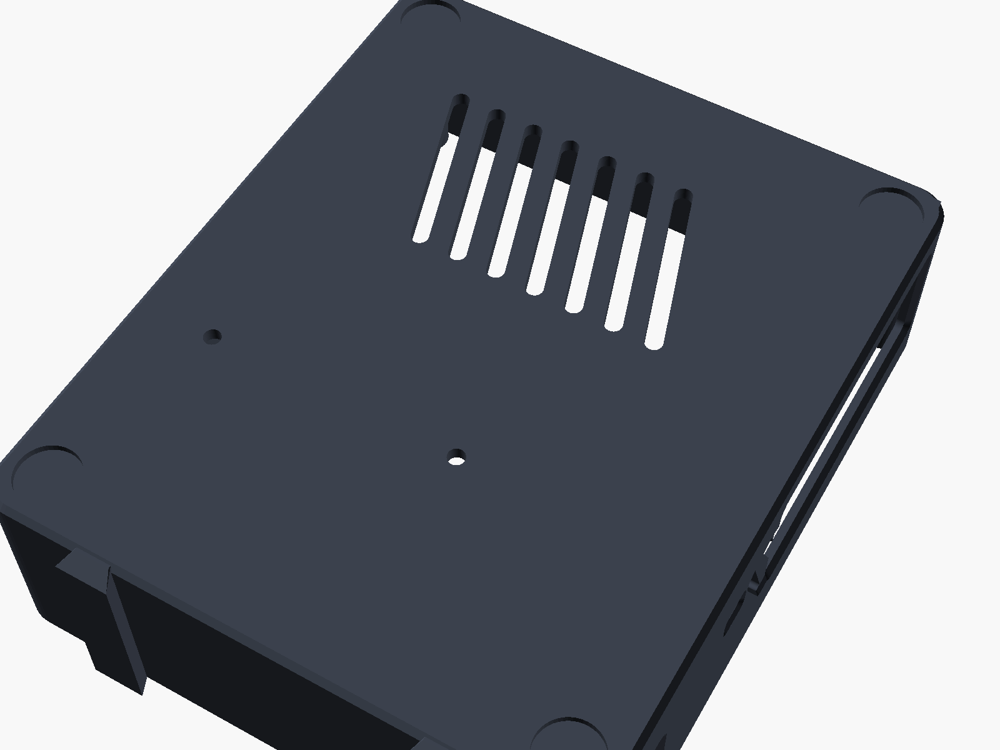

# Pyra Claw case v2 (Pi 5 + ESP32 + PC817 + Coral) and the Nexus phone rack

Parametric OpenSCAD enclosure, restyled from v1. **None of v2 has been test-printed or fit-checked against real hardware: not the case, the lid inlays, the fan parts, or the phone rack.** Print a tolerance coupon and a draft-quality base before committing a full-quality print.

Tags: **[Certain]** = official drawing or datasheet. **[Likely]** = common practice or a secondary source. **[Guessing]** = design estimate; measure it.


## Files
| File | What it is |
|---|---|
| `params.scad` | **All dimensions.** Edit here only. |
| `case.scad` | `base()`, `lid()`, `lid_inlay_wordmark()`, `lid_inlay_claws()`, `fan_guard()`, `esp32_bracket()` |
| `rack.scad` | `rack()`, `shroud()`, `shroud_print()` for the phone rack |
| `base.scad`, `lid.scad`, `lid-mmu-body.scad`, `lid-inlay-*.scad`, `fan-guard.scad`, `esp32-bracket.scad`, `phone-rack.scad`, `phone-rack-shroud.scad` | One part per file, for CLI renders |
| `preview-assembly.scad` | `view="docked"`, `"exploded"`, or `"airflow"` (with ghost boards, fans, phones, and arrows) |
| `preview-from-stl.scad` | Clean colored previews built from the STLs |
| `stl/*.stl`, `preview/*.png` | Pre-rendered with OpenSCAD 2021.01 |

Re-render:
```sh
for p in base lid lid-mmu-body lid-inlay-wordmark lid-inlay-claws esp32-bracket fan-guard phone-rack phone-rack-shroud; do openscad -o stl/$p.stl $p.scad; done
openscad --preview --imgsize=1600,1200 --camera=52,60,12,58,0,325,330 --colorscheme=Tomorrow -o preview/v2-assembly-3q.png preview-from-stl.scad
```
**Font:** the wordmark uses *Orbitron ExtraBold* (Google Fonts, OFL). If it isn't installed, OpenSCAD silently falls back to a default font. Install it, or change `font` in `params.scad`. [Certain]

## Sizes (from the rendered STLs) [Certain for the model; prints will vary]
- Base: **102.8 × 123.8 × 34.4 mm**, or 126.8 mm deep including the two 3 mm dock rails on the back wall. Interior 98 × 119 × 32 mm.
- Lid: 102.8 × 123.8 × 3.0 mm, a flat cap with no lip.
- **Assembled: 102.8 × 123.8 × 37.4 mm** (v1 was 105.8 × 126.8 × 36.8 including lugs).
- ESP32 bracket 59.6 × 32.6 × 13.1 mm. Fan guard 44 × 44 × 4.6 mm.
- Phone rack: **211.3 × 78.6 × 70 mm**. Shroud: 81 × 80 × 38 mm. Each piece fits a 220 × 220 mm bed.

## Changes from v1
- **Removed the external screw lugs.** The lid screws into internal corner bosses that are hulled into the corners. To make room, the interior grew 3 mm per side. [Certain]
- **Rounded hull body.** R6 vertical edges, a 1.6 mm top fillet, and a 1 mm bottom chamfer, which also helps with elephant's foot. [Certain]
- **Lid:**
  - Prints **face up** as a flat cap.
  - Inset front panel with a raised **"PYRA CLAW"** wordmark and three angled **claw-slash** grooves, inspired by `assets/logo.png` but drawn in OpenSCAD.
  - **Hex grille** over the Pi Active Cooler.
  - A slot grille for the new case fan, plus claw-slash exhaust over the Coral.
  - All underside features are shallow recesses, so it needs no supports. [Certain]
- **Slash vents:**
  - Claw-slash intake vents in the right and front walls.
  - Angled slash vents at the left-rear and in the floor under the Pi. [Certain]
- **Chamfered port cutouts** with a 1 mm chamfer, each opening enlarged by 2 mm. [Certain]
- **Recessed foot pockets:** Ø10.5 × 1.2 mm, for 10 mm stick-on bumpers. [Certain]
- **Pi ports sit about 3 mm further back from the outer face** because the interior grew. Most cables should still seat, but **check that USB-C, micro-HDMI, and Ethernet plugs reach**. [Guessing]
- New parts: a 40 mm case fan mount, a fan guard, two-color inlay STLs, two dovetail dock rails, and the phone rack with its fan shroud.

## Layout
The board placement is the same as v1: Pi 5 front-left, ESP32 and perfboard behind it, and the Coral on edge along the back wall. See the v1 source table below; nothing there changed. Openings, by wall:
- Front wall: USB-C and micro-HDMI.
- Right wall: Ethernet/USB, the Coral cable pass-through, and the PWR_SW lead slot.
- Left wall: microSD and ESP32 USB.
- Lid: status-LED hole.




## Printing
| Setting | Value | Tag |
|---|---|---|
| Material | PETG for everything (the Pi 5 and the phones run warm; PLA softens around 55–60 °C) | [Likely] |
| Layer / perimeters / infill | 0.2 mm, 3 perimeters (walls 2.4 mm), 20 % gyroid | [Likely] |
| Supports | **None.** The base prints floor-down. The lid and guard print as exported. The rack prints floor-down. Print the shroud with `phone-rack-shroud.stl`, which is already oriented flange-down. | [Likely] |
| Bridges | Port openings up to about 56 mm. If they sag, slow down the bridges. | [Guessing] |
| Brim | 3–5 mm for the rack, which is long and tall. | [Likely] |

### Optional two-color lid
- **Single extruder (layer swap):** print `lid.stl` and add a filament change (M600 / "Pause/Color change") at **z = 2.2 mm**, which is the top of the inset panel floor (`lid_t - panel_d`). Only the raised wordmark is above that height, so it comes out in the second color. The claw grooves stay the base color. [Likely]
- **Multi-material (AMS / MMU / IDEX):** load `lid-mmu-body.stl`, `lid-inlay-wordmark.stl`, and `lid-inlay-claws.stl` **as parts of one object**. They share one coordinate origin, so don't let the slicer drop them to the bed separately. Assign the accent filament to both inlays. The claw inlay fills the 0.8 mm grooves flush. The wordmark inlay is the 0.8 mm raised lettering. [Likely]


## Airflow and fans


```
 CASE (top view)                          RACK (side view)
 +-------------------------+              fan ->| shroud |  phone  phone  phone | slotted back ->
 |  [Coral]~~>  (40mm FAN) |  ^ exhaust       ==>|  duct  |==> lanes 12mm gaps ==>|==> out
 |   ~~~>  ^ out of lid    |                    ==>|        |==>                  ==>|
 |  [Pi 5 + Active Cooler] |<== intake (right wall slashes)
 +------------^------------+
              intake (front slashes + floor slots)
```
- **Case:** cool air enters through the front and right-wall claw slashes and the floor slots. It crosses the Active Cooler and the Coral, then leaves through the 40 mm fan mounted under the lid over the ESP32 strip, which blows **out** through the lid. The Active Cooler's own fan pulls from the lid hex grille. Intake and exhaust are on opposite sides of the hot parts. [Guessing about real flow; geometry Certain]
- **Case fan:** `case_fan = 40` (default, 40 × 40 × 10 mm, 5 V) or `30`.
  - Screw spacing is **32 mm for 40 mm fans** ([Noctua NF-A4x10 5V spec](https://www.noctua.at/en/products/nf-a4x10-5v/specifications)) and **24 mm for 30 mm fans** ([Sunon size and hole-pitch table](https://www.sunon.cz/nase-novinky/rozmery-ventilatoru-tabulka-velikosti-a-roztece-der/)). [Certain]
  - The fan sits in a 0.6 mm underside seat and is held by self-tap screws from above.
  - The claw-slot grille slots are 2.6 mm, which is finger-safe. [Likely]
  - Print `fan-guard.stl` for an extra guard on 3 mm standoffs. [Certain]
- **Wire channel:** a 1.2 mm groove under the lid runs from the fan to the Pi GPIO header. Connect to **pin 4 (5 V) and pin 6 (GND)**, or use a fan with the Pi 5 4-pin JST fan connector if the Active Cooler isn't using it. [Likely; the Active Cooler normally occupies that connector]
- **Rack fan:** `rack_fan = "80"` (default, 80 × 80 × 25 mm, **71.5 mm hole spacing**, [Noctua NF-A8 5V spec](https://www.noctua.at/en/products/nf-a8-5v/specifications)) or `"2x40"` (2 × 40 mm, 32 mm spacing).
  - The fan screws to the **ducted shroud**. The shroud spreads air over all three phone lanes and exits through the slotted far wall.
  - The shroud attaches with 2 top self-tap screws and 2 alignment pegs. [Certain]
- **5 V vs 12 V:**
  - A 5 V fan can run from a Pi USB port or a USB charger. The Noctua 5 V models ship with a USB adaptor. [Certain per Noctua]
  - A 12 V fan needs a separate 12 V supply, or a 5→12 V boost cable at reduced speed.
  - **Never put a 5 V fan on 12 V.** Noctua explicitly warns against this. [Certain]
- **Temperature-based speed control: not implemented.** [Guessing] The Pi 5 firmware already ramps its own fan header by temperature. A 4-pin PWM fan on GPIO (for example GPIO18 hardware PWM through a logic-level MOSFET for a 3-pin fan) could follow `vcgencmd measure_temp` with a small script, or with the `gpio-fan` / `pwm-fan` device-tree overlays. Untested here.

## Nexus phone rack
For 3 old Nexus phones (5, 5X, 6P) standing on edge, used as a compute cluster.
- **Slots are parametric.** The default is sized for the largest phone in each axis plus a case-free margin: 1.5 mm lengthwise, 0.8 mm across. That gives **slot 10.19 × 162.3 mm**. To use your own measured size, set `phone_override = [L, W, T]` in `params.scad`. [Certain for the math]

| Phone | Size (L × W × T mm) | Source | Tag |
|---|---|---|---|
| Nexus 5 | 137.84 × 69.17 × 8.59 | [PhoneArena](https://www.phonearena.com/phones/Google-Nexus-5_id7993), [GSMArena compare](https://www.gsmarena.com/compare.php3?idPhone1=7588&idPhone2=7556&idPhone3=5705) | [Certain] |
| Nexus 5X | 147.0 × 72.6 × 7.9 | [Google Nexus help](https://support.google.com/nexus/answer/6102470) | [Certain] |
| Nexus 6P | 159.3 × 77.8 × 7.3 | [Google Nexus help](https://support.google.com/nexus/answer/6102470) | [Certain] |

- **Air gaps:** 12 mm between phones and 6 mm at the walls (requirement: ≥10 mm). Each gap lane has floor slash vents. [Certain]
- **Back:** an open slotted far wall with claw slashes, plus a cable slit per lane. [Certain]
- **USB cables:** every slot has a channel at the bottom. The channels lead to a tray and a cross channel that exits on the case-facing side toward the Pi USB ports. Leave about 25 mm (`plug_clear`) for the plug at the bottom edge. [Guessing that right-angle USB-C/micro-USB plugs fit; check yours]
- **Docking:** the rack slides **down** over the two dovetail rails on the case's back wall, and lifts off to remove it. No screws are needed. [Certain for geometry, Guessing for fit; adjust `fit` if it's too tight]
- **Two pieces:** the rack (211.3 mm long) and the shroud each print supports-free within a 220 mm bed. [Certain for size, Likely for no supports]

> ⚠️ **Thermal and battery safety.** Run the phones **without cases**, and keep them at a **reduced charge** (around 40–60 %, using a charge limiter or a smart plug if possible). Old lithium batteries that are held at 100 % and kept warm can **swell**. Check the phones regularly, and **stop using any phone whose back or screen starts to lift.** Never block the fan. Don't leave the cluster running unattended in an enclosed space. PETG softens at about 75–80 °C, so the rack is not a fire barrier. [Likely]

## BOM (generic specs; no prices)
| Qty | Part | Use |
|---|---|---|
| 8 | M2.5 × 4 mm heat-set insert | 4 Pi standoffs + 4 lid corner bosses |
| 4 + 4 | M2.5 × 6 mm and M2.5 × 8 mm screws | Pi to standoffs, and lid to bosses |
| 2 | M2.5 × 8 mm self-tap screws | ESP32 bracket |
| 4 | M2/M2.5 × 6 mm self-tap screws | Perfboard |
| 1 | **40 × 40 × 10 mm 5 V fan** (2-wire or 3-wire, roughly 0.05–0.1 A), or a 30 × 30 mm fan with `case_fan=30` | Case exhaust |
| 4 | Fan self-tap screws (usually included) or M3 screws | Case fan |
| 1 | **80 × 80 × 25 mm 5 V USB fan**, or 2 × 40 × 40 mm 5 V fans | Rack shroud |
| 4–8 | Fan screws (usually included) | Rack fan |
| 2 | M3 × 12 mm self-tap screws | Shroud to rack |
| 8 | 10 mm stick-on rubber bumpers, 1.5–3 mm tall | Foot pockets (4 case + 4 rack) |
| 3 | Short right-angle USB cables | Phones to Pi (or a powered hub) |
| 1 | 5 mm LED + resistor (optional) | Status LED |

## v1 source dimensions (unchanged)
| Item | Value | Source | Tag |
|---|---|---|---|
| Pi 5 PCB / holes / port centres | 85 × 56 mm; 58 × 49 mm hole pattern | [RP-008347-DS](https://pip-assets.raspberrypi.com/categories/892-raspberry-pi-5/documents/RP-008347-DS-1-raspberry-pi-5-mechanical-drawing.pdf) | [Certain] |
| Active Cooler envelope | 63.5 × 42.5 × 13.7 mm | secondary write-up | [Likely] |
| Coral USB Accelerator | 65 × 30 × 8 mm | [Coral datasheet](https://gweb-coral-full.uc.r.appspot.com/docs/accelerator/datasheet/) | [Certain] |
| ESP32 DevKit 38-pin | ~55 × 28 mm | Espressif docs and vendors | [Likely]; measure yours |
| Port housing sizes, insert hole Ø3.6 | estimates | n/a | [Guessing] |
